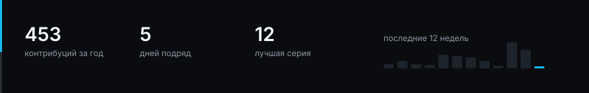

  

 

Пишу продукты целиком: серверную часть, интерфейсы и инфраструктуру.
Люблю системы, где данные живут в одном источнике правды, доступ проверяется
на сервере, а интерфейс не заставляет пользователя думать.

  

  

<picture>
  <source media="(prefers-color-scheme: dark)" srcset="https://raw.githubusercontent.com/evgeha52/evgeha52/output/snake-dark.svg" />
  <source media="(prefers-color-scheme: light)" srcset="https://raw.githubusercontent.com/evgeha52/evgeha52/output/snake.svg" />
  
</picture>

## Как строю

- сервер решает, клиент не доверяется
- авторизация проверяется на бэкенде, а не в браузере
- тонкие обработчики, правила живут в сервисах
- тесты до релиза, а не после
- интерфейс без шаблонной эстетики: одна палитра, читаемая типографика,
  движение только осмысленное

## Репозитории

**[SaasBot](https://github.com/evgeha52/SaasBot)** — Telegram-бот с AI-ответами на Go:
слоистая структура, zap для логов, конфигурация через окружение.

**[hackproject](https://github.com/evgeha52/hackproject)** — веб-приложение для анализа
товаров по кодам ТН ВЭД с рекомендациями по мерам таможенно-тарифного регулирования.